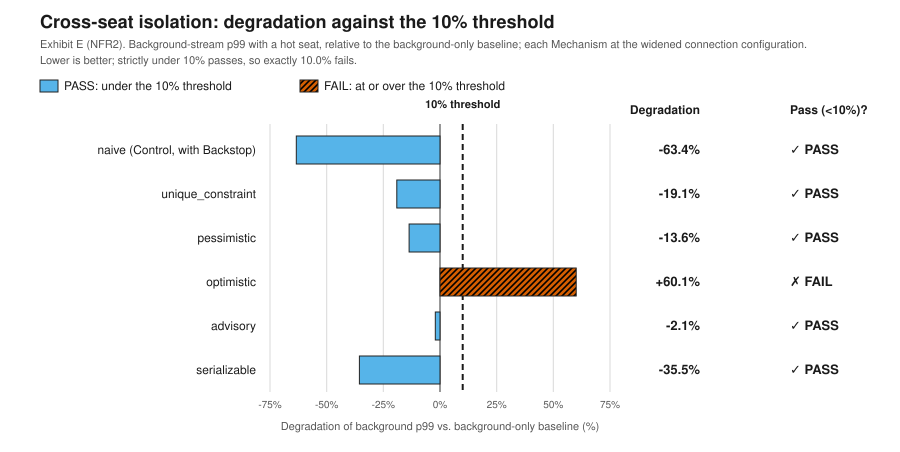

# RaceToSeat

A movie-theatre seat-booking backend with one hard guarantee: **a Seat is never claimed twice, however many requests race for it.** It is also a measured comparison of five concurrency-control **Mechanisms** (unique constraint, pessimistic locking, optimistic locking, advisory locks, serializable isolation) plus an unguarded baseline (the **Control**), all behind one `BOOKING_STRATEGY` flag, so the same API and the same load harness run against each. Built with TypeScript, Fastify and PostgreSQL.

The point is not the API. It is the evidence: which Mechanism to use, and why you should believe it.

## Headline result

- **Use `pessimistic` (`SELECT … FOR UPDATE NOWAIT`) by default.** It is the only Mechanism with the Hold, Confirm and expire flow, it passed the cross-seat isolation requirement, and it held without the Backstop. The evidence does not separate it from `advisory`; the reasons and the costs are in the [recommendation matrix](docs/recommendation-matrix.md).
- **The unguarded Control double-booked** under 1,000 concurrent requests for one Seat (14 and 50 winners in two runs) before the shared uniqueness constraint existed ([Exhibit A](docs/evidence/exhibit-a-naive-double-booking.md)).
- **A shared `UNIQUE(seat_id)` constraint, the Backstop, sits beneath every Mechanism**, so "all pass" does not show each is correct alone. With it removed, the Control double-booked in 6 of 6 runs and the four coordinated Mechanisms held in 24 of 24; the unique-constraint Mechanism, which *is* the Backstop, did nothing ([Exhibit I](docs/evidence/exhibit-i-phase8-no-backstop.md)).
- **Zero Correctness violations in 540 chaos runs** (killed database backends, latency, partitions, a killed application process), judged by checks that read stored state. The unmodified application did exit on the first torn connection, so read that zero with its caveat ([Exhibit H](docs/evidence/exhibit-h-phase6-chaos.md)).
- **Limits:** one machine, one application process, a containerized Postgres, no power-loss test, and no actor or queue variant. [What this does not show](docs/writeup.md#10-what-this-does-not-show) says so plainly.

**Start here:** [the writeup](docs/writeup.md) (about 15 minutes, recommendation first, every claim linked to its exhibit), then [the recommendation matrix](docs/recommendation-matrix.md).



## Run it

You need Node 20 or later and Docker. The load harness also needs [k6](https://k6.io).

```bash
cp .env.example .env            # DATABASE_URL, PORT, BOOKING_STRATEGY
docker compose up -d            # Postgres 17 on :5433, tuned as the exhibits were
npm install
npm run db:migrate
npm run db:seed
```

`.env.example` sets `BOOKING_STRATEGY=naive`, the unguarded Control, because the project began there. To run the recommended Mechanism:

```bash
BOOKING_STRATEGY=pessimistic npm start
```

Other values: `unique_constraint`, `optimistic`, `advisory`, `serializable`. The API is `POST /bookings`, `GET /seats`, `DELETE /bookings/{id}`, and, for `pessimistic` only, `POST /holds` and `POST /holds/{id}/confirm`.

Check the build (the tests need the Postgres container running):

```bash
npm run typecheck
npm test
```

### Reproduce the evidence

```bash
# Load: with the server above running, hammer one Seat with 1,000 concurrent requests
# (patterns: hammer-seat, spread-seats, deadlock-pairs, isolation, hold-expiry)
BOOKING_STRATEGY=pessimistic npm run harness -- --pattern hammer-seat --concurrency 1000 --repeat 2

npm run harness:aggregate -- --exhibit c    # regenerate an exhibit's tables from the committed reports (c, e, f, h, i)
npm run charts                              # regenerate the four charts in docs/charts/
npm run formal:check                        # model-check the TLA+ specs (Docker)
docker compose --profile chaos up -d toxiproxy && npm run chaos   # Fault-injection matrix
```

## Where things are

| | |
|---|---|
| [docs/writeup.md](docs/writeup.md) | The long-form writeup: recommendation, evidence, limits |
| [docs/recommendation-matrix.md](docs/recommendation-matrix.md) | Scenario by Mechanism, every cell cited or "not measured" |
| [docs/evidence/](docs/evidence/) | Exhibits A to I and the per-run JSON reports they are computed from |
| [docs/charts/](docs/charts/) | The four generated charts |
| [docs/adr/](docs/adr/) | Architecture decision records |
| [CONTEXT.md](CONTEXT.md) | The glossary: Mechanism, Control, Backstop, Oracle, Fault and the rest |
| [PRD.md](PRD.md), [problem-statement.md](problem-statement.md), [todo.md](todo.md) | What was asked for, and the roadmap |
| `src/`, `db/`, `load-harness/`, `formal/` | The service, schema, load and chaos harnesses, TLA+ models |
