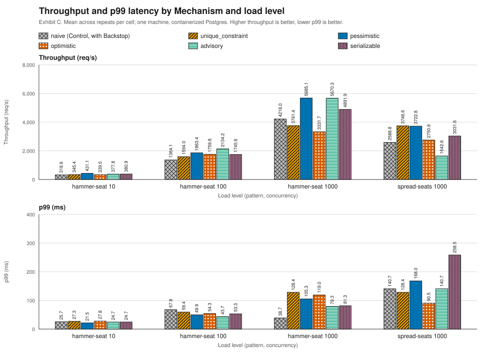
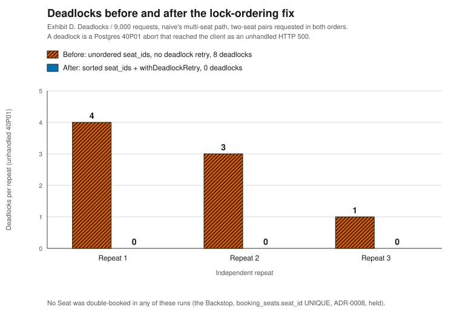
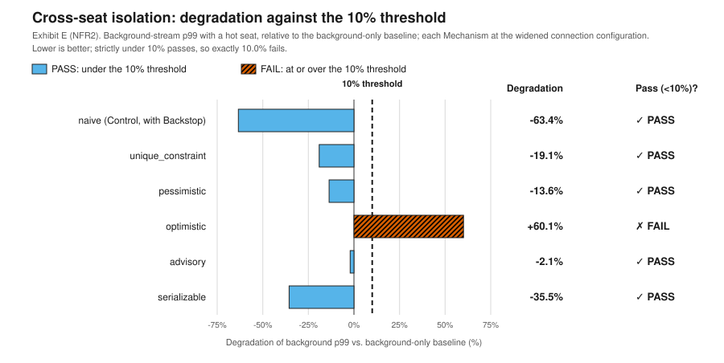
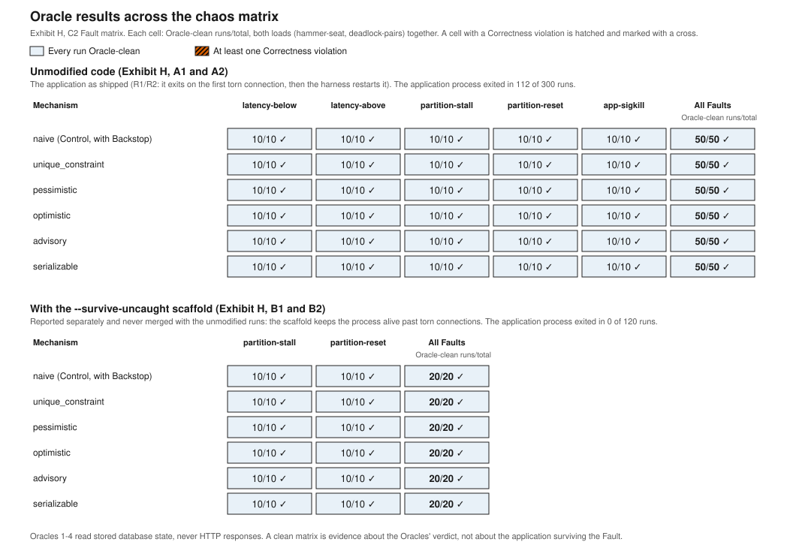

# RaceToSeat: which concurrency Mechanism, and why you should believe it

RaceToSeat books movie-theatre Seats with a hard guarantee that no Seat is ever claimed twice. It runs five interchangeable ways of making that guarantee, plus an unguarded baseline, behind one configuration flag, and tests each against the same load. This document is the evidence-backed answer to "which one should I use?" Every claim links to the exhibit that measured it.

Vocabulary is the project glossary's ([CONTEXT.md](../CONTEXT.md)). A **Mechanism** is one of the five compared: unique constraint, pessimistic locking, optimistic locking, advisory locks, serializable isolation. The **Control** (`naive`) is the unguarded read-then-write baseline, not a Mechanism. The **Backstop** is the `UNIQUE(seat_id)` constraint the shared schema places beneath every Mechanism and the Control. An **Oracle** is a check that reads the stored Seat, Booking and Hold state, never HTTP responses, to decide whether a run broke a guarantee.

## 1. Headline and recommendation

**Use `pessimistic` (`SELECT … FOR UPDATE NOWAIT`) unless the [recommendation matrix](recommendation-matrix.md) says otherwise.**

- **Correctness held everywhere it was measured.** Across 540 measured chaos runs (every Mechanism and the Control, plus the Hold lifecycle, under injected database Faults, a killed application process and a slow link) the Oracles found zero Correctness violations ([Exhibit H](evidence/exhibit-h-phase6-chaos.md)). That zero needs a caveat, given in section 6.
- **The Backstop, not the choice of Mechanism, is the correctness guarantee.** With it in place every Mechanism and the Control pass. Removed, the Control double-booked in 6 of 6 runs and the four coordinated Mechanisms held in 24 of 24 ([Exhibit I](evidence/exhibit-i-phase8-no-backstop.md); at 60 concurrent requests, three repeats, so evidence and not proof).
- **The Mechanisms differ in cost and failure behaviour.** `optimistic` is the one measured failure of the requirement that a hot Seat must not slow others (+60.1% against a 10% limit). `serializable` answers most overlapping multi-Seat requests with `503` when the database link is slow. Throughput and tail latency on a single hot Seat were all in the same range.
- **Why `pessimistic`:** it is the only Mechanism with the Hold, Confirm and expire flow ([ADR-0017](adr/0017-phase5-scoped-to-pessimistic-only.md)); it has no isolation finding ([Exhibit E](evidence/exhibit-e-phase4-isolation.md)); it held without the Backstop ([Exhibit I](evidence/exhibit-i-phase8-no-backstop.md)); and it cannot deadlock by construction ([Exhibit G](evidence/exhibit-g-phase6-formal.md)). The evidence does **not** separate it from `advisory`, and the default rests on the hold flow and the size of its evidence base, not on a measured win. [The matrix](recommendation-matrix.md) gives the reasons and the costs.

## 2. The Backstop, and how to read every number

Every benchmark row in this document ran on a schema in which a Seat can belong to at most one Booking, whatever way the claim was made ([ADR-0008](adr/0008-shared-unique-constraint-on-booking-seats-seat-id.md)). That changes how the results read.

- **The Control's benchmark rows are "Control, with Backstop".** `naive` no longer double-books on this schema, so its "0 double-bookings" says the Control sitting on the Backstop holds, not that unguarded read-then-write is safe.
- **The earliest double-booking evidence, Exhibit A, is the only run of the Control without the Backstop on the project's own schema.** It was taken before the constraint existed: two runs of 1,000 concurrent requests for one Seat produced **14** and **50** winners ([Exhibit A](evidence/exhibit-a-naive-double-booking.md)). It is a historical record, not re-runnable: the exhibit says the current schema no longer reproduces it live. Later no-Backstop runs (Exhibit I, and Exhibit H's negative controls) use a scratch database instead.
- **"All six pass" does not show each Mechanism is correct alone.** The unique-constraint Mechanism is the Backstop with nothing in front of it; the other four put a coordination step in front of it. Exhibit I removes the Backstop from each, on a scratch database built from the real schema, and the Oracles judge:

| | Without the Backstop (60 concurrent, 3 repeats per workload) |
|---|---|
| Control (`naive`) | double-booked in 6 of 6 |
| `pessimistic`, `optimistic` | held 6 of 6; every Booking served |
| `advisory` | held 6 of 6; 89 of 90 pair Bookings served |
| `serializable` | held 6 of 6; 53 of 90 pair Bookings served |
| `unique_constraint` | **inoperative** 6 of 6: books nothing, answers HTTP 500 |

Two results in that table deserve plain statements. First, the exhibit's recorded prediction for `unique_constraint` was that it would double-book; it **missed**. Its `ON CONFLICT (seat_id)` insert needs the unique index to exist, so without it the Mechanism fails closed, booking nothing. The conclusion the prediction was after, that it cannot stand alone, was right. Second, "held" is a safety verdict and not a liveness one: `advisory` and `serializable` served fewer Bookings than a fully served run, which Exhibit I explains with the Mechanisms' designs but did not isolate ([Underfilled runs](evidence/exhibit-i-phase8-no-backstop.md)).

## 3. Mechanism comparison

[Exhibit C](evidence/exhibit-c-phase2-comparison.md) runs all six against two load patterns: every request for one Seat (10, 100 and 1,000 concurrent) and 1,000 requests across 1,000 distinct Seats.

| Pattern, 1,000 concurrent | Mechanism | Throughput (req/s) | p99 (ms) |
|---|---|---|---|
| One Seat | `unique_constraint` | 3,761.4 | 128.4 |
| | `pessimistic` | 5,685.1 | 105.3 |
| | `optimistic` (2 repeats) | 3,331.7 | 119.0 |
| | `advisory` (2 repeats) | 5,670.3 | 79.3 |
| | `serializable` (2 repeats) | 4,891.9 | 81.3 |
| | Control, with Backstop | 4,218.0 | 38.7 |
| Distinct Seats | `unique_constraint` | 3,746.6 | 128.4 |
| | `pessimistic` | 3,722.8 | 168.0 |
| | `optimistic` | 2,750.9 | 90.5 |
| | `advisory` | 1,642.6 | 140.7 |
| | `serializable` | 3,031.6 | 258.5 |
| | Control, with Backstop | 2,588.8 | 140.7 |

Read this table with three cautions.

1. **Single runs.** Most cells are one run; the three Mechanisms with retry behaviour got two repeats on the hot Seat. Differences of a few percent are not findings.
2. **The hot-Seat ranking did not reproduce.** Exhibit C has `pessimistic` first at 5,685.1 req/s. Exhibit H later re-measured the same cell and read 3,752 req/s for `pessimistic` against 6,972 for `unique_constraint` and 5,968 for `advisory`, with 548 of its 2,000 requests lost to the load generator's own connection resets ([Exhibit H, G3](evidence/exhibit-h-phase6-chaos.md)). Read the hot-Seat numbers as "all six in the same range".
3. **Before the Phase 6 fixes.** Exhibit C was not re-run after them. Spot checks at 100 concurrent requests were within its p99 for every Mechanism, and the one fix on the conflict path cost 3% to 11% on p50 ([Exhibit H, section M](evidence/exhibit-h-phase6-chaos.md)).

Do not read the Control's low hot-Seat p99 (38.7 ms) as a result in its favour: it is the Control on top of the Backstop, and no exhibit isolates why it is lower.

## 4. Deadlocks, before and after

A request for several Seats at once can deadlock if two requests acquire the same Seats in opposite orders. [Exhibit D](evidence/exhibit-d-naive-multiseat-deadlock.md) builds that workload: disjoint two-Seat pairs, both orderings of each pair fired at once, 1,500 pairs (3,000 requests) per run, three runs per state.

| Control, with Backstop | Before (request order, no retry) | After (sorted, with deadlock retry) |
|---|---|---|
| Deadlocks per 9,000 requests | **8** | **0** |
| Unhandled HTTP 500s | **8** | **0** |
| Double-booked | no (Backstop held) | no |

Each of the eight was logged server-side with Postgres's own deadlock report. At a smaller scale (600 requests) the same code showed zero, which is why the exhibit records the scale as part of the evidence: "zero after the fix" means something only because the same load produced a nonzero rate before it. Sorting `seat_ids` was enough on its own at this load; the retry helper never had to engage ([ADR-0014](adr/0014-deadlock-retry-gets-its-own-shared-helper.md)). The Control carries the before/after demonstration; the other Mechanisms got the same fix without their own demonstration ([ADR-0016](adr/0016-naive-is-the-sole-deadlock-demo.md)), and the formal model shows why `pessimistic` and `advisory` cannot deadlock at all (section 6).

## 5. Cross-seat isolation

The requirement (NFR2): hammering one Seat must not raise p99 latency for requests against *other* Seats by 10% or more. [Exhibit E](evidence/exhibit-e-phase4-isolation.md) runs a hot-Seat burst and a background stream of distinct Seats concurrently, and compares the background stream's p99 with and without the burst.

| Mechanism | Background p99 change | Against the 10% limit |
|---|---|---|
| `unique_constraint` (2 repeats) | −19.1% | pass |
| `pessimistic` (5 repeats) | −13.6% | pass |
| `optimistic` (5 repeats) | **+60.1%** | **fail** |
| `advisory` (2 repeats) | −2.1% | pass |
| `serializable` (2 repeats) | −35.5% | pass |
| Control, with Backstop (2 repeats) | −63.4% | pass |

Three things in this result are easy to misread.

- **A measurement that did not reproduce.** The first run reported `pessimistic` at +37.5%, a fail. Three single-repeat reruns swung from −41% to +4%, so it was re-measured at five repeats and the exhibit corrected to −13.6%. The other mechanisms' two-repeat rows were never re-run, so their sizes and signs, including the large negative values, are unconfirmed; a negative value is not a speed-up.
- **The negative control.** To show the harness can detect a real violation, `pessimistic` was also run under the project's earlier, smaller connection configuration (Postgres `max_connections=100`, application pool 50): it read +374.7%. Exhibit E attributes that to connection-pool queuing, which is why the passing rows hold only under the widened configuration (`max_connections=600`, pool 500).
- **`optimistic`'s failure is explained and accepted.** It reproduced across reruns. A lost compare-and-swap costs about four extra round trips, which a Postgres query-log comparison confirmed (169 statements for the Control against 405 for `optimistic` on an identical 50-request burst). Doubling the pool only reduced it from +60.1% to +52.3%, ruling out pool spillover. The extra read is ADR-0009's way of telling a real conflict from a cancellation race, so the exhibit's conclusion is to document it as an inherent trade-off of the design, not to fix it ([Exhibit E, Findings](evidence/exhibit-e-phase4-isolation.md)).

## 6. Formal and chaos evidence

**Formal ([Exhibit G](evidence/exhibit-g-phase6-formal.md)).** Four small TLA+ modules, model-checked exhaustively by TLC in a pinned Docker image, cover the claim protocol, deadlock freedom, the Hold lifecycle (Confirm, expire, Reaper, Cancel) and crash recovery with same-key retries. The bounds are three requests and three Seats. All 12 positive checks hold and all 52 negative controls fail for their stated reasons. The seat-ownership invariants hold in every reachable state, including with a backend crash injected at any step (over a million states explored). The deadlock result is the sharpest: blocking acquisition in client order deadlocks in three steps, while sorted or non-waiting acquisition cannot. This is a small-scope check of *abstract protocols* joined to the code by a hand-audited table and a drift test; it is not a proof of the implementation, nor for arbitrary sizes.

**Chaos ([Exhibit H](evidence/exhibit-h-phase6-chaos.md)).** A Fault driver injects a killed database backend, added latency below and above the client timeout, a network partition (stalled and reset) and a killed application process, under two loads, across the five Mechanisms and the Control, and the pessimistic Hold lifecycle. Four Oracles read stored state after each run. Results: 540 measured runs, **zero Correctness violations**, and 16 of 16 end-to-end negative controls flagged (including the Control on a scratch database without the Backstop, since the Backstop stopped it double-booking live).

**Read the zero with its caveat.** The unmodified application exited on the first torn connection: 135 of 143 unmodified runs under a connection-tearing Fault ended with the process gone. Those runs mostly judge little, because the harness restart and key replay then produce a clean state. The meaningful evidence is the separately reported `--survive-uncaught` runs, which keep the process alive to see what the Oracles say under sustained Faults; unmodified and scaffolded results are never merged ([ADR-0022](adr/0022-correct-under-chaos-means-db-state-oracles.md)). The matrix is also limited to at most 120 concurrent clients (a macOS listen-backlog ceiling), far below Exhibits A to F.

## 7. Robustness findings and fixes

A Robustness finding is a failure that leaves every Oracle intact: a crashed process, a hung request, a lock held too long. The chaos track found seven (R1 to R7) and model checking found two more (RF1, RF2). Phase 6 measured first and changed no production code; each finding then became its own fix ticket with a before and after rerun ([Exhibit H](evidence/exhibit-h-phase6-chaos.md), sections E to M).

| Finding | What it was | Outcome |
|---|---|---|
| R1 (#53) | A torn checked-out connection killed the process | Fixed ([ADR-0024](adr/0024-torn-connection-handled-by-a-pool-connect-hook.md)): the process exited in 0 of 67 reruns |
| R2 (#54) | Same, for an idle pooled connection | Closed by R1's listener plus a regression test |
| R3 (#55) | A dead connection masked the real error as a bare 500 | Fixed: designed `502` ([ADR-0025](adr/0025-infrastructure-failure-is-its-own-outcome-502.md)); unclassified 500s fell to 0 in every cell |
| R4 (#56) | No timeouts: a partition stalled requests and row locks for its whole length | Fixed: every wait bounded, `504` ([ADR-0026](adr/0026-database-timeouts-bound-every-wait.md)); a 30 s partition now ends transactions in 1.6 s or less (was 30.1 s) |
| R5 (#58) | `advisory` answered 500 instead of 409 when a loser read a stale snapshot | Fixed ([ADR-0027](adr/0027-advisory-reads-status-after-the-lock-is-held.md)); seen in 1 of 420 matrix runs |
| R6 (#59) | Retry loops multiply slow-link latency | Split by evidence ([ADR-0028](adr/0028-retry-time-budget-for-serializable-optimistic-accepted.md)): `serializable` got a time budget, `optimistic`'s was accepted |
| R7 (#57) | A stalled Reaper blocked unrelated Holds and Confirms | Fixed ([ADR-0029](adr/0029-reaper-sweep-skips-locked-seats.md)): fresh Holds won 12 of 12 (was 0 of 12) |
| RF1 (#60) | An Idempotency Key lived only as long as its Booking row, so a retry after Cancel made a second Booking | Fixed ([ADR-0030](adr/0030-idempotency-keys-outlive-their-rows.md)): such a retry now answers `410` |
| RF2 (#61) | A concurrent same-key retry could be told 409 | Fixed ([ADR-0031](adr/0031-a-refused-claim-rereads-its-key-before-answering-409.md)) at a cost of 3% to 11% on p50 for losing requests |

Two fixes carry honest costs. R6's budget for `serializable` ended client timeouts but lets fewer requests complete, since fewer retries mean fewer chances to win. RF1 changed a contract: a client that cancels and re-books with the *same* key now gets `410`, not a new Booking. Both are measured in the exhibit, not hidden.

## 8. Durability, and its limit

"A returned `COMMIT` survives the database being killed" was assumed by the formal model and, until the last chaos ticket, tested by neither track. [Exhibit H, section N](evidence/exhibit-h-phase6-chaos.md) tests it: 39 runs against a scratch Postgres that is restarted, stopped, or killed with SIGKILL under sustained load. A fifth Oracle checks that every Booking, Hold and Confirm the server acknowledged still exists afterwards ([ADR-0032](adr/0032-durability-is-a-fifth-oracle-fed-by-acknowledgements.md)). Of 90,842 acknowledged operations, none was lost. A server configured to lose commits (`synchronous_commit=off`, then SIGKILLed) lost 5,291, and the fifth Oracle flagged all 9 of 9 such runs, so the check can fail.

**The limit:** a killed container keeps the Docker VM's page cache, so this tests "the server process dies", not power loss or storage that lies about `fsync`. Power loss is untested.

## 9. The recommendation matrix

[The matrix](recommendation-matrix.md) maps seven scenarios (a hot-Seat on-sale spike, low-contention booking, a hot Seat that must not slow others, multi-Seat group Bookings, Hold and Confirm, a schema without the Backstop, a slow database link) to the five Mechanisms and the Control. Every cell cites an exhibit section or reads "not measured", and its last section lists what carries no verdict. It names `pessimistic` as the default and says where not to take it: avoid `optimistic` if a hot Seat must not slow others; expect `serializable` to answer most overlapping multi-Seat requests with `503` on a slow link; and treat the unique-constraint Mechanism as the layer beneath the other four, not an alternative to them.

## 10. What this does not show

- **One machine, one application process, one containerized Postgres.** No multi-node application servers, no replicas, no very large Events.
- **Not power loss.** Section 8 states the edge of the durability claim.
- **Not the actor or per-Seat-queue variant.** It was a scope decision, named in the roadmap as optional (Phase 7), and it is unmeasured future work: no verdict on how it compares.
- **Concurrency below the headline load in two places.** The no-Backstop experiment ran at 60 concurrent requests, not 1,000, because the chaos harness could not carry 1,000 on this machine; the chaos matrix tops out near 120.
- **Hold and confirm only for `pessimistic`**, and not measured without the Backstop.
- **Mostly single or few-repeat runs.** Exhibit C's cells are single runs, and its hot-Seat ranking did not reproduce. Treat small differences as noise.
- **Formal results are bounded** to three requests and three Seats and describe protocols, not the code line by line.
- **Hardware and pool sensitivity.** The PRD's own risk note stands: results depend on hardware and connection-pool configuration, and the negative control in section 5 shows how much.

## 11. How this differs from a standard tutorial version

This note lists only this project's own concrete choices; it says nothing about any other project.

- **The unguarded failure comes first.** The Control is built and run under load before any fix, and [Exhibit A](evidence/exhibit-a-naive-double-booking.md) records 14 and 50 winners for one Seat.
- **Five Mechanisms and the Control behind one flag.** `BOOKING_STRATEGY` selects a Mechanism per process ([ADR-0002](adr/0002-process-level-strategy-selection.md)), so the same API and the same load harness run against each.
- **An adversarial deadlock harness.** It builds overlapping multi-Seat requests with opposing lock orders to force deadlocks ([Exhibit D](evidence/exhibit-d-naive-multiseat-deadlock.md)).
- **A measured isolation requirement with a negative control.** NFR2 has a numeric threshold, and a deliberately undersized pool shows the harness can see a violation ([Exhibit E](evidence/exhibit-e-phase4-isolation.md)).
- **Formal and chaos tracks, each with negative controls.** Every checker is shown to fail on a broken variant (52 formal controls, 16 end-to-end chaos controls) ([Exhibit G](evidence/exhibit-g-phase6-formal.md), [Exhibit H](evidence/exhibit-h-phase6-chaos.md)).
- **The Backstop is itself tested.** Exhibit I removes the Backstop to see which Mechanisms stand alone, and records a prediction it got wrong.

## 12. Test environment and provenance of the numbers

**Machine** (inferred; the reports carry no hardware metadata, and versions were read on the development machine while writing Exhibit H): Apple M4, 10 cores, 16 GB, macOS 27.2.1; Docker Desktop 4.70.0 (engine 29.4.0; the VM was given 10 CPUs and 8.3 GB per Exhibit G); Node v25.6.1; k6 v2.2.0. Chaos faults used Toxiproxy 2.12.0. The reports for Exhibits A to F carry timestamps of 22 to 25 August 2026 and Exhibit H's chaos matrices of 25 November 2026 (its Postgres-restart runs, and Exhibit I, ran on 26 November 2026). Whether the earlier reports ran on identical hardware is not recorded.

**Database:** `postgres:17` (17.10) in a container, started with `deadlock_timeout=100ms` and `max_connections=600` (`docker-compose.yml`). **Application:** one process; the connection pool holds up to 500 connections (`PG_POOL_MAX`); since the R4 fix, server-side `statement_timeout` and `idle_in_transaction_session_timeout` of 1.5 s, a client `query_timeout` of 2 s and a connection timeout of 2 s ([ADR-0026](adr/0026-database-timeouts-bound-every-wait.md)). **Load generator ceiling:** macOS's listen backlog (`kern.ipc.somaxconn` = 128) produces connection resets above roughly 130 simultaneous k6 connections with no Fault at all, which caps the chaos loads.

**Which numbers predate which fixes.** Exhibits C, D, E and F were measured before the Phase 6 fixes and were not re-run; Exhibit D's "before" is the deliberately unfixed multi-Seat path and its "after" the sorted and retried one. Exhibit H's early sections judge unmodified code; each later section names the fix it follows. Exhibit I ran after all of them. The [matrix's provenance table](recommendation-matrix.md#which-numbers-were-measured-before-or-after-fixes) gives the exhibit-by-exhibit detail.

**Reproduce it.** [README.md](../README.md) lists the commands. Every exhibit's tables are regenerated from the committed JSON reports (`npm run harness:aggregate`), and the four charts from the same reports (`npm run charts`); a test fails if an embedded chart no longer matches the generator.
